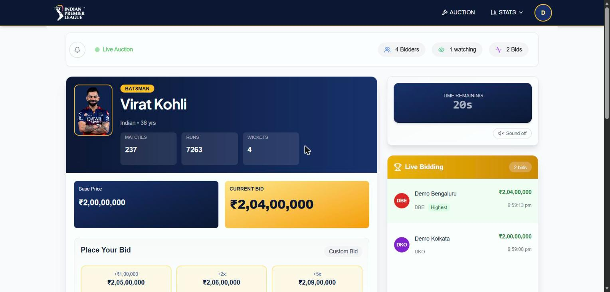
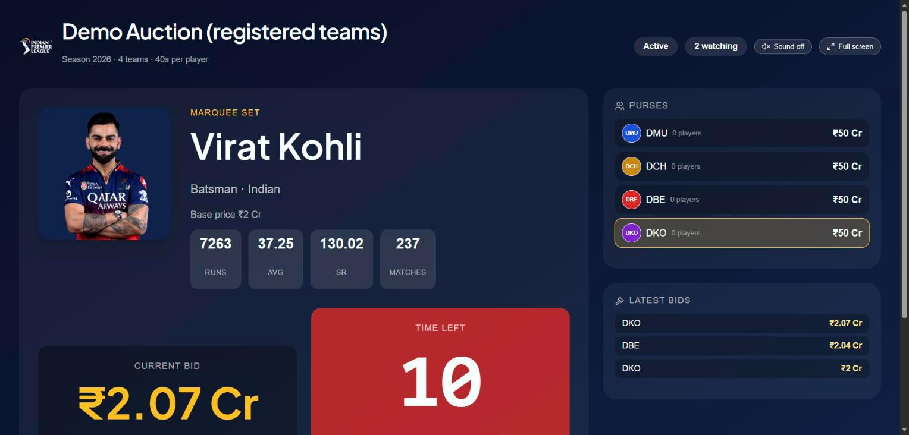
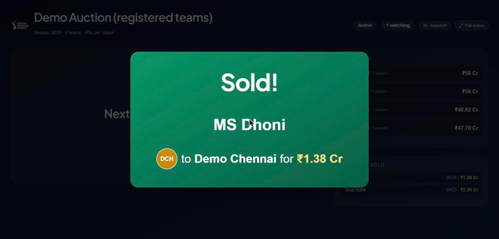
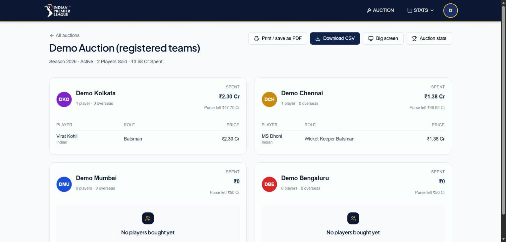
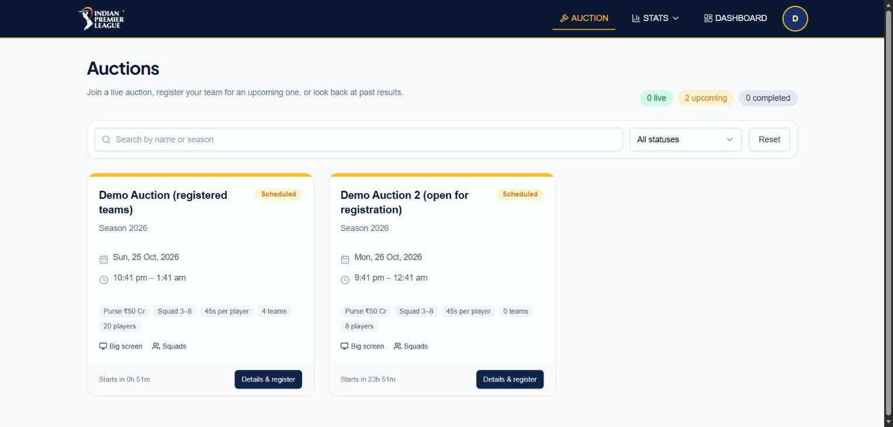
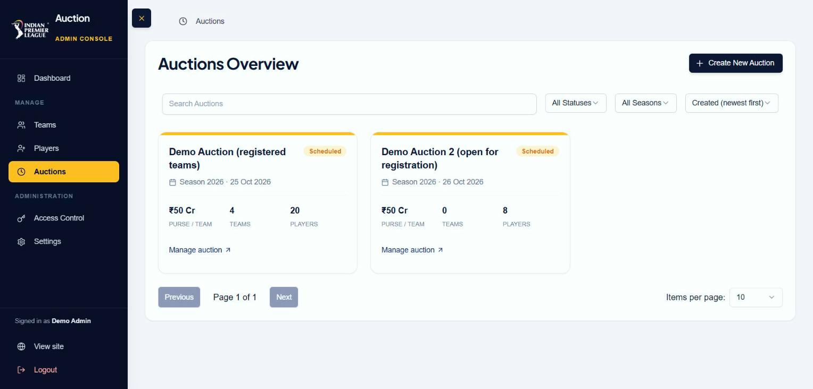

# IPL Auction

**A real-time, multi-team player auction in the style of the IPL.** Team owners bid live from their own browsers while
the server runs the whole auction on its own clock: it opens at the scheduled time, sells each player when the
countdown ends, lets owners vote unsold players back in for one more round, then completes and archives the results.


> An unofficial fan project. It is not affiliated with or endorsed by the IPL or the BCCI.

## Live demo

**https://iplauction.tarunsumanthpuli.in**

Public pages (live auctions, big screen, squads, stats) need no account. To try the signed-in roles, use a demo account
with the password `Demo@12345`:

| Role | Email | Lands on |
| --- | --- | --- |
| Admin | `admin@demo.ipl` | Dashboard: auctions, teams, players, access control |
| Auctioneer | `auctioneer@demo.ipl` | Assigned auctions |
| Team owner | `owner1@demo.ipl` … `owner4@demo.ipl` | Auctions: register a team and bid |

Sign in as two or three owners in separate browser windows to watch live bidding. The demo data is shared and may be
reset at any time.

## Screenshots

| Live bidding (owner view) | Big screen for a projector or stream |
| --- | --- |
|  |  |

| SOLD result banner | Squads, with CSV export |
| --- | --- |
|  |  |

| Public auctions list | Admin console |
| --- | --- |
|  |  |

## Highlights

- **Server-driven auctions.** Nobody has to press "start" or "sold". The server opens the auction at its start time,
  runs the per-player clock, sells to the highest bidder, brings up the next player and finishes by itself. An admin
  can still pause, skip a player, sell now or undo the last bid.
- **Fair, race-free bidding.** Every bid is a single conditional database update, so two simultaneous bids can never
  both win. Purse, squad-size, overseas-player and minimum-squad rules are enforced on the server. A bid in the last
  10 seconds resets the clock to 10 (anti-sniping).
- **Owners' vote.** When the players run out, unsold ones go to a 30-second vote. Players with at least one vote come
  back for one more round; the auction then completes and archives itself.
- **Live everywhere.** Socket.IO keeps every owner, spectator and the **big-screen view** (a TV-friendly page for a
  projector or stream) in sync, with going-once / going-twice cues and a SOLD / UNSOLD result banner.
- **Roles and security.** Admin, team owner, optional auctioneer and anonymous visitor. Roles are enforced on the
  server for every route and socket event. Invite and password-reset links, deactivation, an activity log, rate
  limits and security headers are built in.
- **Admin tooling.** A setup checklist, auction presets (Mega, Mini, Quick practice), CSV import for players, squads
  and CSV export, and public auction results and stats.
- **Tested.** 32 fast unit tests and 10 integration suites that run a real server, a real database and real sockets.

## Tech stack

| | |
| --- | --- |
| **Backend** | Node.js 20–24 (22 LTS recommended), Express 4, MongoDB (Mongoose 8, replica set), Socket.IO 4, node-cron, JWT in an `httpOnly` cookie, helmet, express-rate-limit |
| **Frontend** | React 18, Vite 6, React Router 7, Redux Toolkit (RTK Query), Tailwind CSS 3, shadcn/ui (Radix), Framer Motion, socket.io-client |
| **Testing** | `node:test` for unit tests; custom integration runner with throwaway databases |

## Who does what

| Role | How they get an account | What they do |
| --- | --- | --- |
| **Admin** | `npm run seed:admin` creates the first one | Creates players, teams and auctions, imports players from CSV, invites people, resets passwords, deactivates accounts, reads the activity log. Can pause, skip, undo bids and complete any auction. |
| **Team owner** | Signs up (creating their team at the same time), or via an admin invite when `SIGNUP_MODE=invite` | Registers their team for an auction and bids. |
| **Auctioneer** *(optional)* | Invited by an admin; sets their own password | Can run the auctions assigned to them. An auction runs fine without one. |
| **Visitor** | No account | Watches live auctions, the big-screen view, results, squads and stats. Cannot bid. |

Everyone signs in on the same page and lands on the right screen for their role.

## How an auction runs

1. **Set up (admin).** Create an auction (start from a preset), add players and teams, optionally group players into
   sets. A checklist on the auction page shows what is still missing. Owners can also register their own team.
2. **It opens by itself at the start time.** There is deliberately no "start now": time is time. Until then rules and
   times can be edited; once it opens they are locked (only the name can change).
3. **Players come up one at a time**, in set order (marquee, capped, uncapped, accelerated), each with a countdown.
4. **Bidding.** A bid must beat the current bid by the minimum increment. The leading team can't outbid itself, a team
   can't bid more than its purse, and it must keep enough purse to still reach the minimum squad size. It also can't
   exceed the **overseas-player limit** (counted over its whole squad).
5. **Sold or unsold.** When the clock ends the player goes to the highest bidder, who pays at that moment (the purse
   is charged on a sale, never on a bid), or is marked unsold. The SOLD / UNSOLD result stays on screen for a few
   seconds before the next player's clock starts.
6. **The vote.** Unsold players go to a 30-second owners' vote. Voted players come back for one extra round. If nobody
   votes, or the extra round is done, the auction completes and archives itself.
7. **Afterwards.** Squads, a CSV export and stats are public. A team can be in only **one unfinished auction at a
   time**; after it completes it can join another, keeping its squad with a fresh purse.

### Screens

| Path | What |
| --- | --- |
| `/auctions` | All auctions with their rules, sizes and links to the big screen and squads |
| `/auction/:id` | The live auction (owners bid here; admins get the controls) |
| `/auction/:id/screen` | **Big screen:** read-only, TV-friendly view for a projector or stream |
| `/auction/:id/squads` | Every team's squad, printable, with CSV download |
| `/stats/auctions` | Results: top buys, biggest spenders, price by role, unsold players |
| `/stats` | Player career stats |
| `/dashboard` | Admin: auctions, teams, players (CSV import), access control, activity log |

## How it works

```
 Browser (React) ──REST (RTK Query)──▶ Express ──▶ MongoDB (replica set)
        ▲                                 │
        └──────── Socket.IO rooms ◀───────┤  one room per auction
                                          ▼
                       auction clock + cron (in the server process)
```

- **The server owns the clock.** A once-a-minute cron opens scheduled auctions and recovers after a restart; a
  per-auction timer sells the player when time runs out. Clients only display the countdown (corrected for any clock
  difference between the device and the server).
- **Atomic bids.** `placeBidAtomic` checks status, current player, time, increment, leader, purse and squad rules and
  applies the bid in one `findOneAndUpdate`.
- **The sale uses the live bid** for that turn, so an old bid from an earlier round can never decide a sale.
- **Single instance.** The owners' vote and the clocks live in memory; only the "sell and move on" step is protected
  across processes by a short database lease. Run one backend instance.

## Quick start

You need **Node 20–24** (22 LTS recommended) and **MongoDB running as a replica set** (signup uses transactions, which MongoDB only allows on
a replica set).

### 1. MongoDB (Docker example)

```yaml
# compose.yaml
services:
  mongodb:
    image: mongo:8
    container_name: mongodb
    restart: unless-stopped
    ports: ["127.0.0.1:27017:27017"]
    environment:
      MONGO_INITDB_ROOT_USERNAME: ${MONGO_ROOT_USERNAME}
      MONGO_INITDB_ROOT_PASSWORD: ${MONGO_ROOT_PASSWORD}
    volumes: [mongo_data:/data/db]
    command:
      - bash
      - -c
      - |
        [ -f /data/db/mongo-keyfile ] || openssl rand -base64 756 > /data/db/mongo-keyfile
        chmod 400 /data/db/mongo-keyfile
        chown mongodb:mongodb /data/db/mongo-keyfile
        exec docker-entrypoint.sh mongod --replSet rs0 --bind_ip_all --keyFile /data/db/mongo-keyfile
volumes:
  mongo_data:
```

Start it, then initiate the replica set **once**:

```bash
docker compose up -d
docker exec mongodb mongosh -u "$MONGO_ROOT_USERNAME" -p "$MONGO_ROOT_PASSWORD" --authenticationDatabase admin \
  --eval 'rs.initiate({_id:"rs0", members:[{_id:0, host:"localhost:27017"}]})'
```

Create a database user for the app (in the `admin` database) with `readWrite` on `ipl_auction`.

### 2. Backend

```bash
cd backend
cp .env.example .env        # then edit MONGO_URL and JWT_KEY
npm install
npm run dev                 # http://localhost:8080
```

### 3. Frontend

```bash
cd frontend
cp .env.example .env
npm install
npm run dev                 # http://localhost:5173
```

If the backend isn't on `http://localhost:8080`, set `VITE_API_URL` in `frontend/.env`.

### 4. Your first admin

```bash
cd backend
ADMIN_EMAIL=you@example.com ADMIN_PASSWORD='at-least-8-chars' ADMIN_NAME='Your Name' npm run seed:admin
```

It refuses to run once an admin exists (so it can't be used to take over a live system). Further admins are made from
**Dashboard → Access Control**. If every admin is locked out, add `ALLOW_ADDITIONAL_ADMIN=1` to create another.

### Try it with demo data

```bash
cd backend
npm run seed:demo                       # 1 admin, 1 auctioneer, 4 team owners (each with a team), 20 players, 2 auctions
npm run seed:demo -- --start-in=10      # first auction opens in 10 minutes (default 3)
npm run seed:demo -- --bid-time=60      # seconds per player (default 45)
npm run seed:demo -- --reset            # removes only the demo data
```

Every demo account uses the password `Demo@12345` (`admin@demo.ipl`, `auctioneer@demo.ipl`, `owner1@demo.ipl` …
`owner4@demo.ipl`). The script refuses to run with `NODE_ENV=production`. Sign in as two or three owners in separate
browser windows to see live bidding.

## Configuration (`backend/.env`)

| Variable | Default | Meaning |
| --- | --- | --- |
| `MONGO_URL` | — | MongoDB connection string (replica set) |
| `JWT_KEY` | — | Secret that signs logins. Must be long and random (32+ characters): anyone who can guess it can sign in as any user, admins included. A weak key makes a `NODE_ENV=production` server refuse to start, and warns in development. Generate one: `node -e "console.log(require('crypto').randomBytes(48).toString('base64url'))"` |
| `JWT_EXPIRES_IN` | `1d` | How long a login lasts (`30m`, `12h`, `7d`, …). The login cookie lasts exactly as long |
| `CLIENT_URL` | `http://localhost:5173` | Frontend address (CORS and the links in invites / resets) |
| `SIGNUP_MODE` | `open` | `invite` makes owner signup need an admin invite |
| `RESULT_BREAK_SECONDS` | `5` | How long a SOLD / UNSOLD result stays up before the next player comes (no clock runs meanwhile); `0` brings the next player up immediately |
| `PORT` | `8080` | Server port |
| `TRUST_PROXY` | unset | Number of reverse proxies in front, so rate limits see real client IPs |

Frontend (`frontend/.env`): `VITE_API_URL` is the backend address (default `http://localhost:8080`), read at build time.

Invite and password-reset links are shown to the admin to copy and send; there is no email service.

## Tests

```bash
cd backend
npm test                        # fast unit tests (~1 s): rules, CSV import, emails, permissions, reports
npm run test:integration        # ~5 minutes: real server + real database + real sockets
npm run test:integration -- bidding     # only suites whose file name contains "bidding"
```

The integration tests start their own servers against throwaway databases named `<your db>_test` (plus `_test_invite`,
`_test_limits` and `_test_pause`). Each server gets its own database (two servers sharing one would both run the auction scheduler
on the same auctions), the suites empty it between runs, and everything is dropped at the end. They refuse to run
against any database whose name doesn't end in `_test`, so your data is never touched. Three suites play an auction in
real time, which is why the full run takes a few minutes.

## Project layout

```
backend/
  index.js            server, sockets, the auction clock and automation
  routes/             API routes
  controllers/        request handlers
  models/             Mongoose schemas and auction rules
  middlewares/        auth, roles, rate limits
  services/           auction completion and reports (squads, CSV, stats)
  utils/              shared helpers (tokens, audit log, CSV import, ...)
  scripts/            seedAdmin.js, seedDemo.js, runIntegration.js
  tests/              unit/ and integration/
frontend/
  src/
    pages/            one component per screen
    components/       feature components and shared UI (shadcn/ui in components/ui)
    api/              RTK Query endpoints
    store/            Redux slices
    hooks/ lib/       hooks and helpers
```

## License

Released under the [MIT License](LICENSE).
